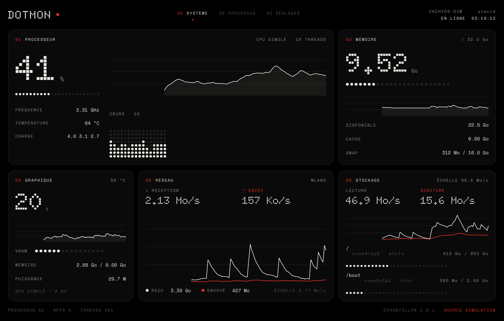
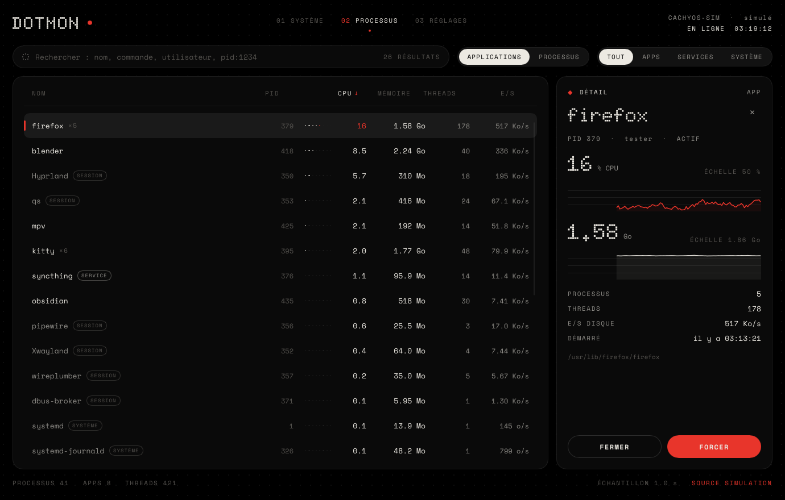
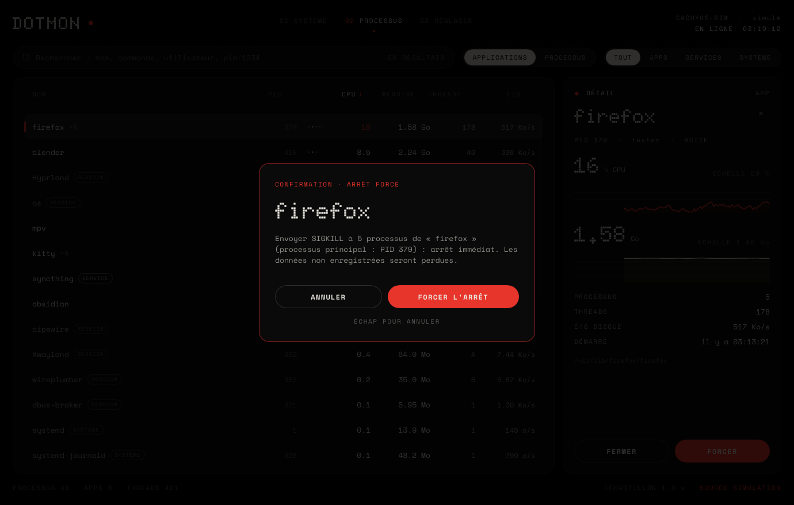

# Dotmon

[](https://github.com/RyusAceVA/dotmon/actions/workflows/ci.yml)


Moniteur système et gestionnaire de tâches **natif Linux / Wayland**, en Rust + Slint
(pas d'Electron, pas de Qt, pas de X11). Esthétique « matrice de points » : fond noir,
blanc cassé, gris anthracite, accents rouges.

*English: Dotmon is a native Wayland system monitor and task manager written in Rust
with Slint (CPU, memory, NVIDIA/AMD GPU, disks, network, processes). It can end
processes safely (SIGTERM / SIGKILL as two separate, confirmed actions, via `pidfd`,
never as root). The interface is currently French only. Beta software, tested on
CachyOS + Hyprland.*



| Processus | Confirmation d'un arrêt forcé |
|---|---|
|  |  |

*Captures réalisées avec la machine simulée (`--mock`) : aucune donnée personnelle.*

## Fonctionnalités

- **Métriques réelles** : CPU (par cœur, fréquence, température), mémoire et swap,
  GPU NVIDIA (NVML) et AMD (sysfs), disques, réseau. Une mesure indisponible s'affiche
  « Indisponible », jamais une valeur inventée.
- **Veille GPU respectée** : une carte NVIDIA endormie n'est jamais interrogée (donc
  jamais réveillée) ; Dotmon n'est pas la raison pour laquelle elle consomme.
- **Processus** regroupés en applications, recherche, filtres, tri, détail avec historique.
- **Fermeture sûre** : FERMER = `SIGTERM`, FORCER = `SIGKILL`, deux actions distinctes
  avec confirmation liée à l'identité exacte du processus (PID + heure de démarrage),
  envoi par `pidfd`, résultat réel affiché (envoyé ≠ terminé), **jamais d'escalade
  automatique**. PID 1, threads noyau, Dotmon, la session (Hyprland, Quickshell),
  PipeWire, portails, services système et processus d'autres utilisateurs sont
  protégés. Détails : [`docs/PHASE3.md`](docs/PHASE3.md), [`SECURITY.md`](SECURITY.md).
- Aucune élévation de privilèges : ni root, ni `sudo`, ni Polkit.

## Installer

### Arch Linux / CachyOS (AUR)

```fish
yay -S dotmon-bin      # binaire précompilé (construit par la CI sur Arch)
# ou
yay -S dotmon          # compilé depuis les sources
```

*(Une fois les paquets publiés sur l'AUR.)* Les deux paquets installent `/usr/bin/dotmon`,
l'entrée de lanceur et les icônes, et sont en conflit l'un avec l'autre.

### Depuis les sources, comme paquet Pacman

```fish
git clone https://github.com/RyusAceVA/dotmon && cd dotmon/packaging/arch
./dist.sh && makepkg -si          # en utilisateur normal, jamais avec sudo
```

Mise à jour : `packaging/arch/update.sh`. Désinstallation : `sudo pacman -Rns dotmon`.
Dépannage de l'icône dans le lanceur : [`docs/PACKAGING.md`](docs/PACKAGING.md).

### Dépendances

Exécution : `fontconfig`, `wayland`, `libxkbcommon`, `hicolor-icon-theme`, une police système (`ttf-font`)
(+ `glibc`, `gcc-libs`). Optionnelles : `nvidia-utils` (mesures du GPU NVIDIA), `libglvnd`
(rendu OpenGL facultatif ; le rendu par défaut est logiciel). Compilation : `rust` (≥ 1.92).

## Développement

```fish
cargo run --release                 # données réelles
cargo run --release -- --mock       # machine simulée
cargo test --workspace --release    # 186 tests (dont tests sur la machine réelle et UI headless)
scripts/compare.sh 10               # comparaison avec top, free, ps, df, sensors, sysfs (verdicts)
scripts/charge.sh cpu 4 60          # charges contrôlées à valeur attendue (cpu, ram, disque, réseau)
scripts/gpu-veille.sh               # suit la veille de la RTX sans jamais la réveiller
```

Protocole de validation sur machine réelle : [`docs/PROTOCOLE.md`](docs/PROTOCOLE.md).

Raccourcis : `Ctrl+1/2/3` pages · `Ctrl+F` recherche · `Échap` annuler / fermer le détail.

Réglages : `~/.config/dotmon/settings.toml` (écrit seulement quand un réglage change).

Règle Hyprland possible (app-id `dotmon`) :

```lua
hl.window_rule({ match = { class = "^dotmon$" }, float = true, size = "1380 880" })
```

Rendu : logiciel par défaut (≈3 % d'un cœur, ≈32 Mio). Rendu OpenGL :
`SLINT_BACKEND=winit-femtovg dotmon` (même CPU, ≈140 Mio avec le pilote NVIDIA).

Validation des mesures et écarts normaux : [`docs/VALIDATION.md`](docs/VALIDATION.md).

## Architecture

Voir [`docs/ARCHITECTURE.md`](docs/ARCHITECTURE.md).

```
crates/
  dotmon-core/   logique pure : modèle, historique, requêtes, regroupement en apps,
                 politique de protection, réglages, géométrie des graphiques
  dotmon-sys/    backends système : linux (réel : métriques + fermeture par pidfd), mock (simulation)
  dotmon-app/    binaire : moteur (thread), présentateur, pont Slint, UI .slint
```

## Licence

Copyright © 2026 RyusAceVA. Dotmon est distribué sous **GPL-3.0-only** (voir [`LICENSE`](LICENSE)) : l'interface
utilise Slint sous sa licence GPL-3.0. Composants tiers et polices :
[`docs/THIRD-PARTY.md`](docs/THIRD-PARTY.md). Journal : [`CHANGELOG.md`](CHANGELOG.md). Publication : [`docs/PUBLISHING.md`](docs/PUBLISHING.md).

## Polices

- **Doto** (chiffres et titres à matrice de points) — SIL Open Font License 1.1
- **Space Mono** (texte) — SIL Open Font License 1.1

Licences dans `crates/dotmon-app/ui/fonts/`. Aucune police, aucun logo
ni élément propriétaire de Nothing n'est utilisé. Dotmon n'est pas affilié à Nothing.
